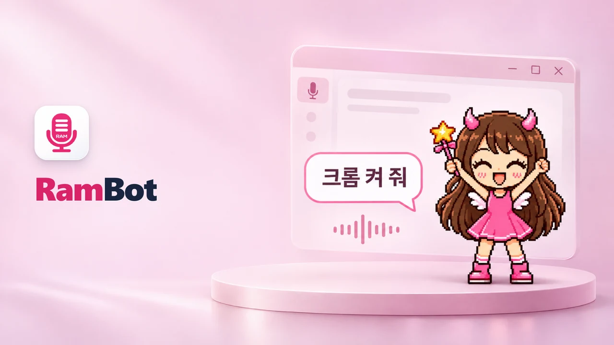
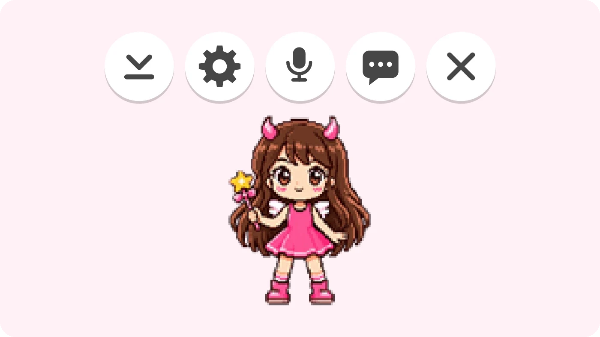
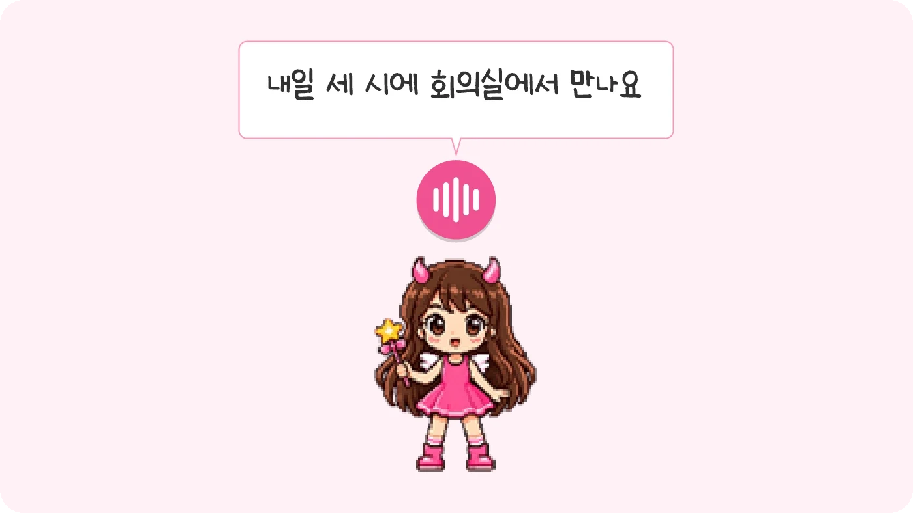
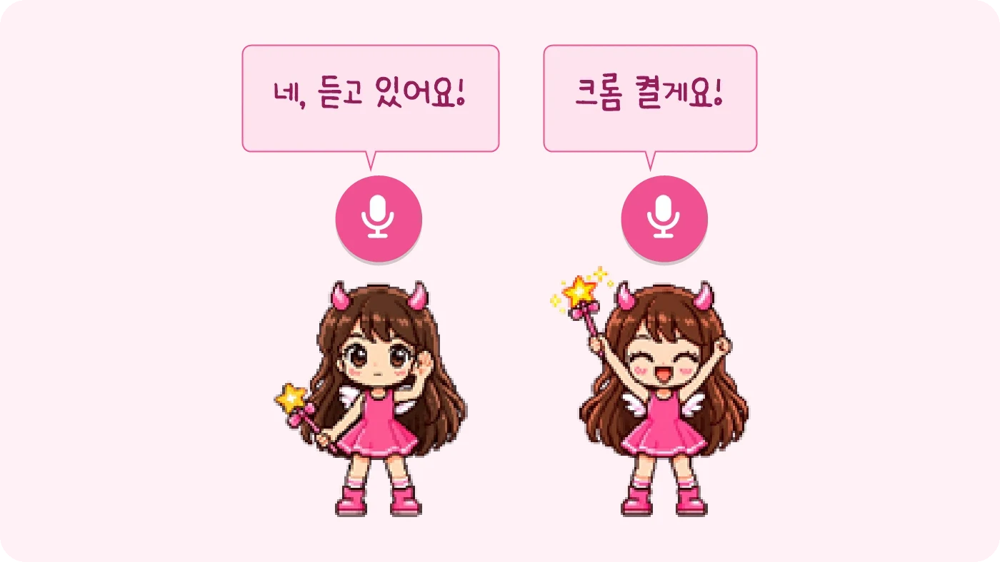
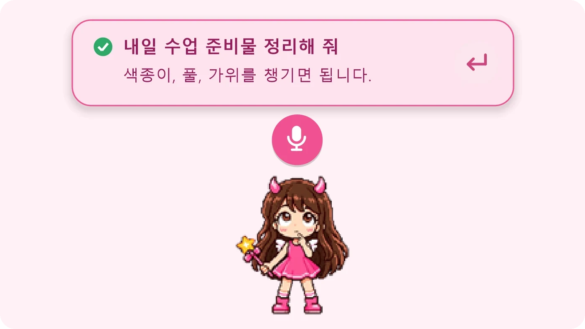
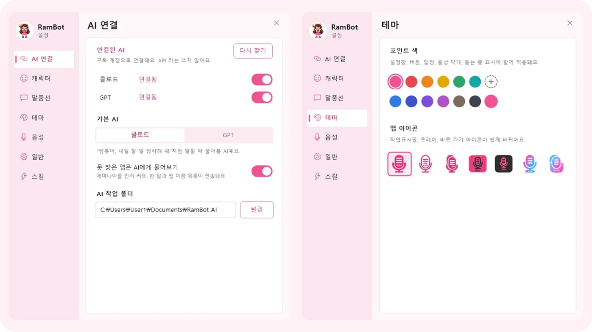
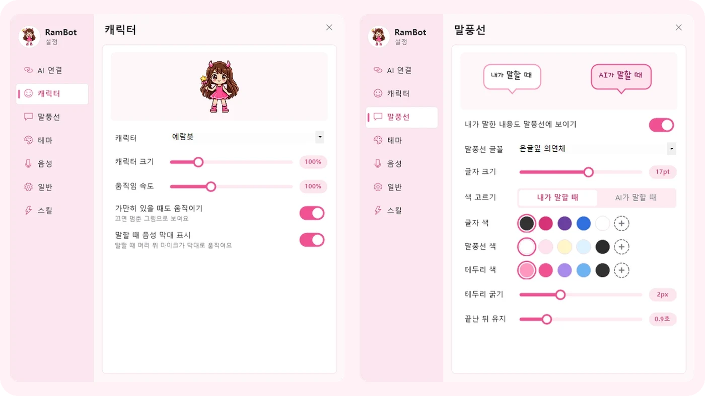
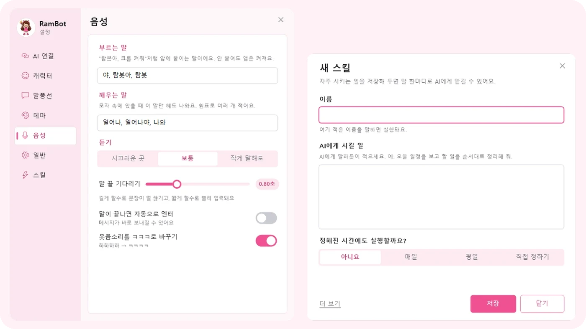

  

  <a href="https://github.com/dpfkadpfka/RamBot/releases/latest/download/RamBot.zip"><b>RamBot.zip 내려받기</b></a>
  &nbsp;·&nbsp; <a href="https://github.com/dpfkadpfka/RamBot/releases/latest">최신 릴리스</a>
  &nbsp;·&nbsp; <a href="https://dpfkadpfka.github.io/apps/guide-rambot.pdf">사용 가이드 (PDF)</a>
  &nbsp;·&nbsp; <a href="https://dpfkadpfka.github.io/">예람쌤 홈페이지</a>

Windows 10 · 11 &nbsp;|&nbsp; 무료 &nbsp;|&nbsp; 음성은 이 PC 안에서만 처리 &nbsp;|&nbsp; 새 버전은 자동 업데이트

---

## 01 · RamBot 소개
말로 글을 쓰고, 말로 앱을 여는 바탕화면 캐릭터

RamBot은 윈도우 바탕화면 위에 떠 있는 작은 캐릭터 도우미예요. 입력칸을 클릭해 두고 말하면 글자로 받아 적어 주고, "크롬 켜 줘"라고 말하면 앱을 열어 줘요. 음성 인식은 인터넷으로 보내지 않고 이 컴퓨터 안에서만 처리해요.

 그림 1 · 마우스를 올리면 버튼이 나와요 (숨기기 · 설정 · 음성 · 대화 · 닫기)

### 이런 걸 할 수 있어요

| 기능 | 내용 |
|---|---|
| 말로 받아쓰기 | 카톡, 한글, 크롬 등 어느 입력칸이든 말한 내용을 글자로 넣어요 |
| 말로 앱 열기 | "크롬 켜 줘", "유튜브 열어 줘"처럼 말하면 앱·사이트·폴더·윈도우 설정을 열어요 |
| AI에게 묻기 | "클로드한테 번역해 줘", "람봇아, 할 일 정리해 줘"처럼 말로 AI에게 물어봐요 |
| 스킬 | 자주 하는 지시를 이름 하나로 저장하고, 정해진 시간에 저절로 돌려요 |
| 마법 모자 | 캐릭터를 모자 속에 숨겼다가 "일어나"라고 부르면 다시 나와요 |
| 꾸미기 | 캐릭터, 말풍선 글꼴·색, 포인트 색, 앱 아이콘 7가지 |
| 업데이트 | 새 버전이 나오면 저절로 받아서 바꿔요 |

> [!TIP]
> 음성 받아쓰기와 음성 명령은 이 컴퓨터 안에서만 처리돼요. AI에게 물어볼 때만 그 내용이 해당 AI 서비스로 전송돼요.

### 차례

| | 주제 | 다루는 것 |
|---|---|---|
| 02 | [설치하기](#02--설치하기) | 파일 받기 · 경고 창 넘기기 · 음성 엔진 |
| 03 | [말로 받아쓰기](#03--말로-받아쓰기) | 듣기 켜고 끄기 · 입력칸에 넣기 |
| 04 | [말로 앱 열기](#04--말로-앱-열기) | 음성 명령 · 부르는 말 |
| 05 | [잘 알아듣게 하기](#05--잘-알아듣게-하기) | 자주 쓰는 말 · 고쳐 쓰기 |
| 06 | [AI에게 묻기](#06--ai에게-묻기) | 클로드 · GPT 연결 |
| 07 | [스킬](#07--스킬) | 자주 하는 일 저장 · 예약 실행 |
| 08 | [마법 모자와 동작](#08--마법-모자와-동작) | 숨기기 · 캐릭터 동작 |
| 09 | [설정과 꾸미기](#09--설정과-꾸미기) | 설정 탭 · 내 캐릭터 넣기 |
| 10 | [업데이트](#10--업데이트) | 자동 업데이트 · 바뀐 점 |
| 11 | [자주 묻는 질문](#11--자주-묻는-질문) | |

---

## 02 · 설치하기

1. 위의 **[RamBot.zip 내려받기](https://github.com/dpfkadpfka/RamBot/releases/latest/download/RamBot.zip)** 를 눌러 파일을 받아요.
2. 압축을 풀고 폴더를 원하는 곳(바탕화면, 문서 등)에 둬요.
3. 폴더 안의 **RamBot.exe** 를 실행해요.
4. 처음 한 번 음성 엔진을 내려받아요.
   - NVIDIA 그래픽카드가 있으면 약 2.1GB (빠르고 정확해요)
   - 없으면 약 0.5GB (말이 끝나고 몇 초 뒤에 입력돼요)

> [!WARNING]
> 「Windows의 PC 보호」 창이 뜨면 **추가 정보 → 실행** 을 눌러요. 개인이 만든, 서명되지 않은 프로그램이라 나오는 안내예요. 처음 한 번만 뜨면 돼요.

---

## 03 · 말로 받아쓰기

- 캐릭터를 누르면 **듣기** 가 켜져요. 다시 누르면 꺼져요.
- 입력칸을 클릭해 두고 말하면, 말이 끝날 때 글자가 들어가요.
- 캐릭터는 끌어서 원하는 곳으로 옮길 수 있어요.

 그림 2 · 받아 적는 동안 말한 내용이 말풍선으로 보여요

> [!NOTE]
> 듣기를 켜 두면 주변 사람 말소리나 음악 가사도 입력될 수 있어요. 말로 입력하지 않을 때는 꺼 두세요. **자동 엔터** 를 켜면 말이 끝나자마자 메시지가 보내질 수 있어요.

---

## 04 · 말로 앱 열기

"크롬 켜 줘", "카톡 열어 줘", "유튜브 켜 줘"처럼 말하면 알아듣고 말풍선으로 알려 줘요. 목록을 적어 두지 않아도 이 컴퓨터의 앱, 윈도우 설정, 폴더를 찾아서 열어요.

 그림 3 · "람봇아"라고 부르면 대답하고, 명령을 알아들으면 "크롬 켤게요!"라고 알려 줘요

| 이렇게 말해요 | 하는 일 |
|---|---|
| 크롬 켜 줘 · 클로드 켜자 | 이 PC의 앱 열기 |
| 유튜브 켜 줘 · 네이버 열어 줘 | 자주 쓰는 사이트 열기 |
| 소리 설정 열어 줘 | 윈도우 설정 열기 |
| 예람으로 로그인해 줘 | 크롬을 그 프로필로 열기 (비밀번호는 입력하지 않아요) |
| 람봇아 | 이름만 불러도 "네, 듣고 있어요!" 하고 대답 |

- 앞에 **"야"** 나 **"람봇아"** 를 붙이면 이름 일부만 말해도 찾아요. 발음이 조금 달라도 비슷한 이름을 찾아요.
- 커서가 카톡·한글·크롬 입력칸처럼 **글 쓰는 곳** 에 있을 때는, "크롬 켜 줘"만 말하면 앱을 켜지 않고 받아 적어요. 글 쓰는 중에 앱을 켜려면 **"야 크롬 켜 줘"** 처럼 말해요. (설정 → 음성에서 끌 수 있어요)

> [!TIP]
> 설정 → AI 연결 → **못 찾은 앱은 AI에게 물어보기** 를 켜면 "사진 고치는 거 켜 줘" 같은 말도 알아들어요. 이때 한 말과 앱 이름 목록이 AI로 전송돼요. 기본은 꺼져 있어요.

---

## 05 · 잘 알아듣게 하기

교안, 하이톡처럼 학교에서 쓰는 낱말은 음성 인식이 헷갈릴 때가 있어요. 설정 → 음성에서 도와줄 수 있어요.

| 설정 | 적는 법 | 하는 일 |
|---|---|---|
| 자주 쓰는 말 | `교안, 하이톡, 나이스` | 소리가 비슷할 때 이 낱말로 받아 적어요 |
| 고쳐 쓰기 | `교한=교안, 고안=교안` | 받아 적을 때 왼쪽 말을 오른쪽 말로 바꿔요 |

> [!NOTE]
> 고쳐 쓰기는 다른 낱말 속에 들어 있어도 바뀌어요. 너무 짧은 말은 넣지 않는 게 좋아요.

---

## 06 · AI에게 묻기

PC에 아래 프로그램을 설치하고 **구독 계정으로 로그인** 해 두면 RamBot이 찾아서 연결해요. API 키는 쓰지 않아요.

| AI | 준비 |
|---|---|
| 클로드 | Claude Code 설치 + 로그인 |
| GPT | Codex 설치 + ChatGPT 계정 로그인 |

 그림 4 · AI가 답하는 동안 캐릭터 옆에 카드가 떠요

- "클로드한테 이 문장 영어로 번역해 줘", "GPT한테 회의 안건 정리해 줘"처럼 말해요.
- **기본 AI** 를 정해 두면 "람봇아, 할 일 정리해 줘"처럼 AI 이름 없이 말해도 돼요.
- 물어본 대화는 클로드 앱과 ChatGPT 앱의 대화 목록에도 남아서 이어 갈 수 있어요.
- **대화** 버튼을 누르면 글로도 물어볼 수 있어요.

---

## 07 · 스킬

"학부모 답장 써 줘", "아침마다 오늘 할 일 알려 줘"처럼 자주 하는 지시를 이름 하나로 저장해요.

1. 설정 → 스킬 → **새 스킬** 을 눌러요.
2. 이름과 AI에게 시킬 일을 적어요.
3. 말로 이름을 부르거나 **[실행]** 을 눌러요.
4. 결과는 말풍선과 **결과 보기** 폴더에 남아요.

- **정해진 시간에도 실행할까요?** 에서 매일이나 평일을 고르면, RamBot이 꺼져 있어도 그 시간에 돌아가요.
- 기본은 **읽기** 만 해요. 파일 고치기를 켜면 실행할 때마다 확인 창이 떠요.

---

## 08 · 마법 모자와 동작

**숨기기** 를 누르면 캐릭터가 마법 모자 속으로 쏙 들어가요. 모자를 누르거나 "람봇아 나와", "일어나"라고 하면 다시 나와요.

 그림 5 · 마법 모자에서 캐릭터가 나오는 모습

 그림 6 · 끌 때는 달리고, 잡고 있으면 매달리고, 못 알아들으면 갸우뚱해요

---

## 09 · 설정과 꾸미기

캐릭터에 마우스를 올리고 **설정** 을 누르면 설정 창이 열려요.

 그림 7 · AI 연결 · 테마

 그림 8 · 캐릭터 · 말풍선

 그림 9 · 음성 · 새 스킬 만들기

| 탭 | 바꿀 수 있는 것 |
|---|---|
| AI 연결 | 연결된 AI 확인 · 기본 AI · 못 찾은 앱은 AI에게 묻기 |
| 캐릭터 | 캐릭터 고르기 · 크기 · 움직임 속도 |
| 말풍선 | 글꼴 · 크기 · 내가 말할 때와 AI가 말할 때의 색 |
| 테마 | 포인트 색 · 앱 아이콘 7가지 |
| 음성 | 부르는 말 · 깨우는 말 · 자주 쓰는 말 · 고쳐 쓰기 · 듣기 감도 · 자동 엔터 |
| 일반 | 윈도우 켤 때 자동 실행 · 말로 카톡 대화창 열기 · 트레이에만 두기 · OneDrive로 설정 맞추기 |
| 스킬 | 스킬 만들기 · 고치기 · 실행 |

### 내 캐릭터 넣기

RamBot 폴더의 **characters** 안에 새 폴더를 만들고 투명 배경 PNG를 넣으면, 설정 → 캐릭터에서 고를 수 있어요.

| 파일 이름 | 동작 |
|---|---|
| `idle_1.png` … | 평소 |
| `listen_1.png` … | 듣는 중 |
| `talk_1.png` … | 받아 적는 중 |
| `think_1.png` … | 생각 중 |
| `happy_1.png` … | 명령 성공 |
| `confused_1.png` … | 못 알아들음 |
| `hold_1.png` … | 잡혀 있을 때 |
| `run_right_1.png` · `run_left_1.png` … | 끌 때 |

idle만 있어도 움직이고, 없는 동작은 평소 그림으로 보여요. 다른 사람이 만든 캐릭터는 사용 권한을 꼭 확인해 주세요.

---

## 10 · 업데이트

- 켜 있는 동안 10분마다 새 버전을 확인하고, 새 버전이 나오면 저절로 받아서 바꾼 뒤 다시 켜져요.
- 듣는 중이거나 설정 창을 열어 둔 동안에는 기다렸다가 바꿔요.
- 작업 표시줄의 RamBot 아이콘을 오른쪽 클릭 → **업데이트 확인** 으로 바로 확인할 수 있어요.
- 버전마다 바뀐 점은 [릴리스 목록](https://github.com/dpfkadpfka/RamBot/releases)에서 볼 수 있어요.

---

## 11 · 자주 묻는 질문

<b>말한 내용이 인터넷으로 나가나요?</b>

음성 받아쓰기와 음성 명령은 이 컴퓨터 안에서만 처리돼요. AI에게 물어볼 때, 그리고 "못 찾은 앱은 AI에게 물어보기"를 켰을 때만 그 내용이 해당 AI 서비스(Anthropic, OpenAI)로 전송돼요.

<b>"크롬 켜 줘"라고 했는데 켜지지 않고 글자로 들어가요.</b>

커서가 글 쓰는 칸에 있으면 받아쓰기로 처리해요. **"야 크롬 켜 줘"** 처럼 앞에 "야"나 "람봇아"를 붙여 말해 주세요. 이 기능은 설정 → 음성에서 끌 수 있어요.

<b>특정 낱말을 자꾸 잘못 받아 적어요.</b>

설정 → 음성 → **자주 쓰는 말** 에 그 낱말을 적고, 그래도 틀리면 **고쳐 쓰기** 에 `틀린말=바른말` 로 적어 주세요.

<b>그래픽카드가 없는 컴퓨터에서도 되나요?</b>

돼요. 작은 음성 엔진(약 0.5GB)을 받아서, 말이 끝나고 몇 초 뒤에 입력돼요.

<b>여러 컴퓨터에서 같은 설정으로 쓸 수 있나요?</b>

설정 → 일반 → **설정과 스킬 맞추기** 를 켜면 OneDrive를 거쳐 설정과 스킬이 같아져요. 두 컴퓨터 모두 같은 OneDrive 계정으로 로그인해야 해요.

---

## 사용 기술

- 음성 인식: [whisper.cpp](https://github.com/ggml-org/whisper.cpp) (MIT 라이선스), Whisper 모델 (MIT 라이선스). 음성 엔진과 모델은 처음 켤 때 공식 배포처에서 내려받아요.
- 화면: C# WinForms (.NET Framework 4)

만든 사람 김예람 · RamBot은 각 AI 서비스와 관계없는 개인 프로젝트예요

